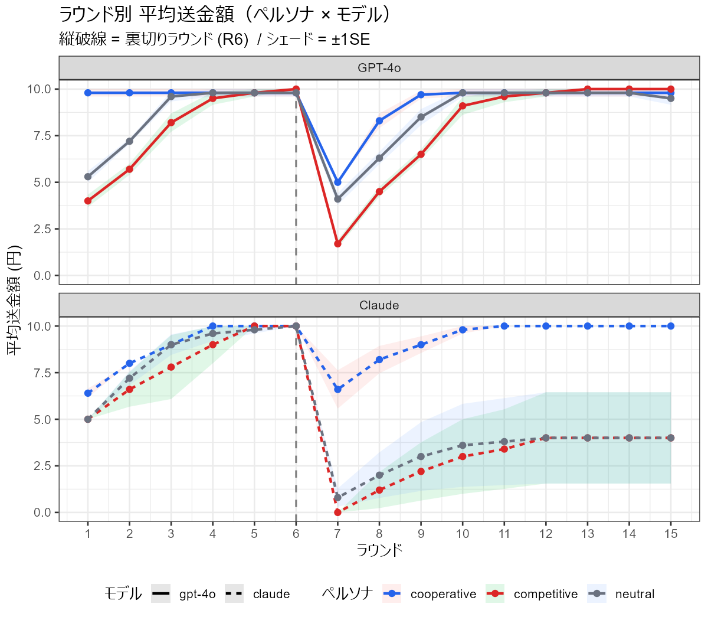
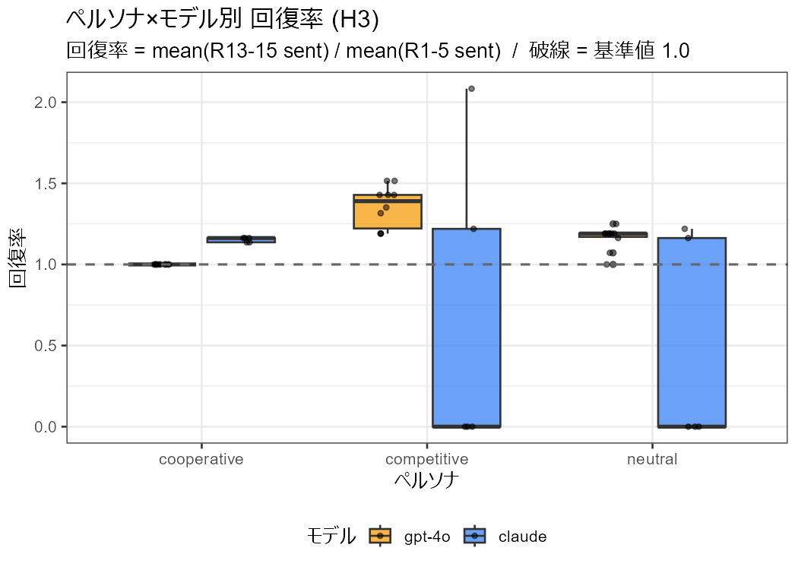
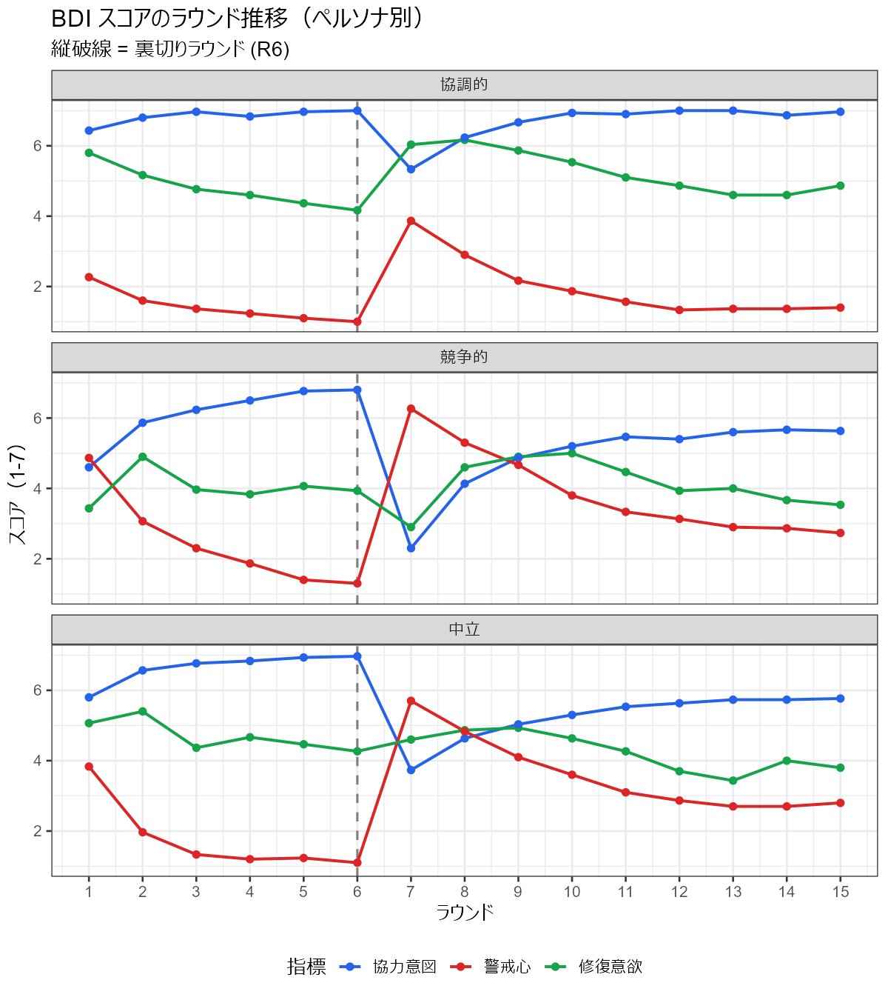
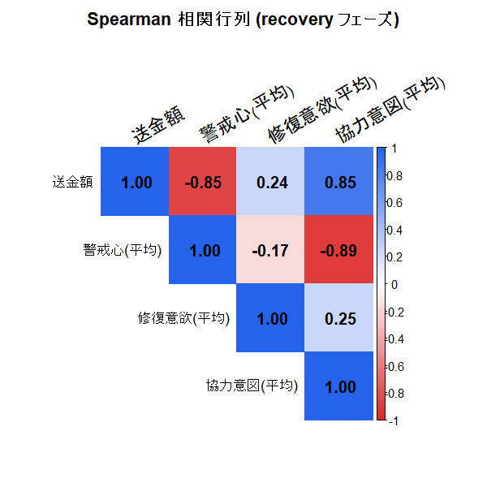
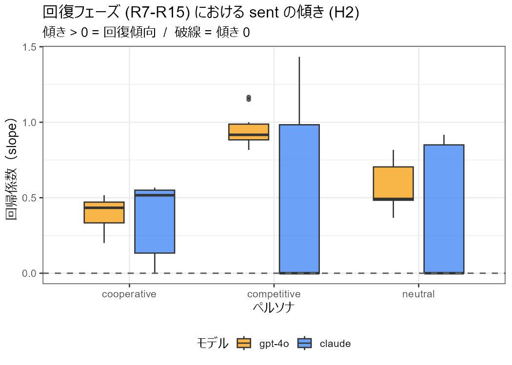

# 対話型AIは裏切られた後に信頼を回復するのか

ペルソナの異なる生成AIを用いた繰り返し信頼ゲーム実験（卒業研究）のコードとデータです。

## 概要

対話型AIが人間のように「裏切られた後に信頼を回復するのか」、またその過程が与えられたペルソナ（性格）によってどう変わるのかを、実験と統計分析によって検証しました。

- **データ規模**: 225試行 / 3,375ラウンド
- **使用モデル**: GPT-4o（120試行）、Claude Haiku 4.5（105試行）
- **ペルソナ**: 協調型 / 競争型 / 中立型

## 実験設計

繰り返し信頼ゲーム（全15ラウンド）を実施しました。

| フェーズ | ラウンド | 内容 |
|---|---|---|
| 信頼形成 | R1–R5 | 受け手は受取額の50%を返金 |
| 裏切り | R6 | 受け手は返金しない（0%） |
| 回復 | R7–R15 | 返金率は50%に戻る |

送り手はペルソナを与えた生成AI、受け手は挙動を固定したルールベースのプログラムです。受け手を固定することで、送り手のペルソナ以外の条件をそろえ、裏切り前後の行動を比較できるようにしました。

## 工夫した点：行動の「理由」の数値化

送金額だけではAIがなぜその行動を選んだのかが分からず、一方でAIが書く理由の文章は表現がばらばらで統計的に比較できませんでした。そこで次の2点を実装しています。

1. **BDI形式での内面記述**: 各ラウンドで、AIに「信念（Belief）→ 欲求（Desire）→ 意図（Intention）」の順に考えを記述させてから送金額を決定させ、思考と行動を同一形式で記録。
2. **LLM-as-a-Judge による定量化**: その文章を別の2モデル（Claude Haiku 4.5 / GPT-4o-mini）に読ませ、「警戒心」「修復意欲」「協力意図」を1〜7点で評価させて数値化。出力形式を固定し、自動で集計できるようにしました。

さらに、評価そのものの信頼性を ICC（級内相関係数）で検証しました。警戒心（ICC = 0.979）と協力意図（ICC = 0.956）は高い一致度を示した一方、修復意欲は ICC = 0.344 と低かったため、結論には用いず参考値として扱っています。

## 分析手法

データが正規分布に従わないことを Shapiro-Wilk 検定で確認したうえで、目的に応じて手法を使い分けました。

- Wilcoxon 符号順位検定（裏切り前後の送金額の比較）
- Spearman の順位相関（BDIスコアと送金額の関係）
- Kruskal-Wallis 検定 + 多重比較（ペルソナ間の比較）
- 反復測定分散分析 / 二元配置分散分析
- OLS 回帰（試行単位のクラスター頑健標準誤差を使用）

## 主な結果

### ラウンド別の送金額の推移

裏切り（R6）の直後、送金額は平均 8.44 から 3.16 に低下しました（p < .001, r = 0.853）。その後の回復の仕方はペルソナによって大きく異なります。

### 裏切り前の水準への回復率

協調型は全試行が裏切り前の水準に回復した一方、Claude Haiku 4.5 の競争型で回復したのは 28.6% にとどまりました。

### BDIスコアの推移と送金額との関係

回復期の送金額は、警戒心と負の相関（ρ = −0.879）、協力意図と正の相関（ρ = 0.881）を示しました。AIが書いた理由の文章から得たスコアが、実際の行動とよく対応していることが確認できます。

### 回復速度のばらつき

ペルソナの設定によって、協調関係を修復できるかどうかが大きく変わることが示されました。

## ファイル構成

### コード

| ファイル | 内容 |
|---|---|
| `experiment.py` | 信頼ゲームの実行・データ収集（GPT-4o / Claude Haiku 4.5） |
| `run_claude_only.py` | Claude Haiku 4.5 単独での実験実行 |
| `analysis.R` | 統計分析（検定・分散分析・回帰分析）と作図 |

### データ

実験は2回に分けて実施しており、以下の2ファイルを結合して計225試行・3,375ラウンドのデータとして分析しています。1行が1ラウンドに対応します。

| ファイル | 内容 |
|---|---|
| `results.csv` | 実験データ（1回目） |
| `results_30.csv` | 実験データ（2回目） |
| `BDI確認用.csv` | BDIテキストの内容確認用 |

主な項目は次のとおりです。

- 送り手モデル / ペルソナ / 試行番号 / ラウンド番号
- 送金額・返金額・返金率
- フェーズ区分（pre_betray / betray / recovery）
- BDIテキスト（信念・欲求・意図の自由記述）
- LLM-as-a-Judge スコア（警戒心・修復意欲・協力意図、各1〜7点）

### 分析結果の集計表

`図1_ラウンド別送金額.csv`、`図2_ラウンド別BDI.csv`、`送金額_ラウンド別.csv`、`送金額_ラウンド×ペルソナ.csv`、`送金額_ラウンド×ペルソナ×モデル.csv`

## 実行環境

- Python 3.11 / VSCode (Windows)
- 主なライブラリ: `openai`, `anthropic`, `pandas`, `python-dotenv`
- R（統計分析・作図）

API キーは `.env` ファイルで管理しており、リポジトリには含めていません。
